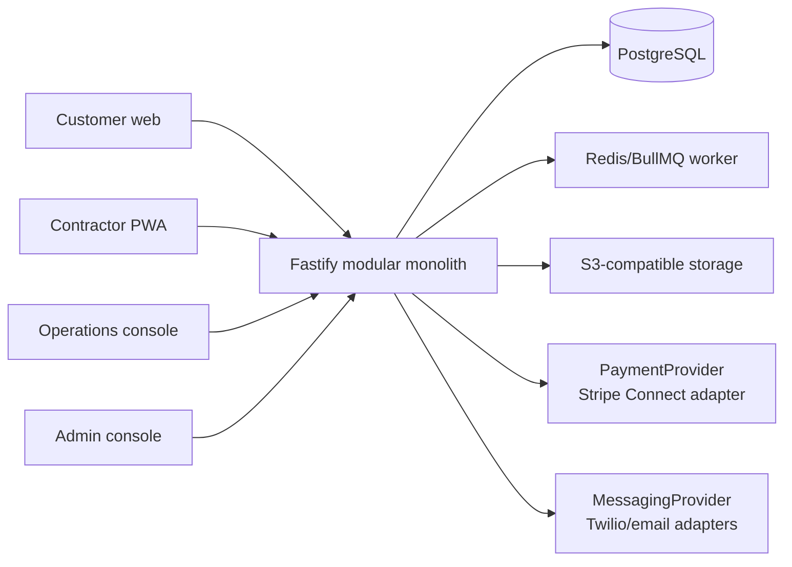

# Architecture

The repository is intentionally a modular monolith. Domain modules communicate through typed command boundaries and an internal outbox/event bus. This keeps transactional workflows simple for the launch phase while allowing dispatch, payments, notifications, or analytics to be extracted later.

## Boundaries

`vertical-engine` owns vertical configuration and rules. Core modules never branch on `hvac`; each request references a `verticalId`, a configurable service category, and issue type. `contracts` contains API/domain types and `validation` owns schemas. React applications call API contracts and never implement pricing, authorization, or state-transition rules.

## Assumptions

- Launch geography and currencies are configured per vertical; seed data uses CAD.
- Stripe is invoked through an adapter. Local development uses a deterministic test provider so no payment credentials are required.
- Human operations is authoritative for qualification, reassignment, holds, refunds, and dispatch overrides.
- Files are represented by storage keys in the MVP; production upload uses pre-signed S3 POSTs with content scanning before use.
