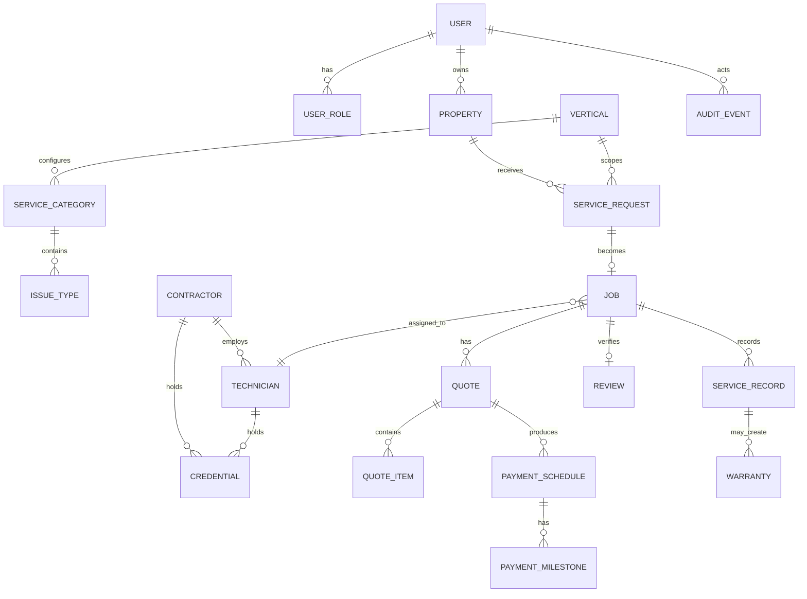

# Domain Model and ERD

All money is stored as integer minor units with ISO currency. Financial and audit records are immutable/append-only. User-facing records use soft deletion where permitted; retained financial/audit data can be anonymized rather than erased.
