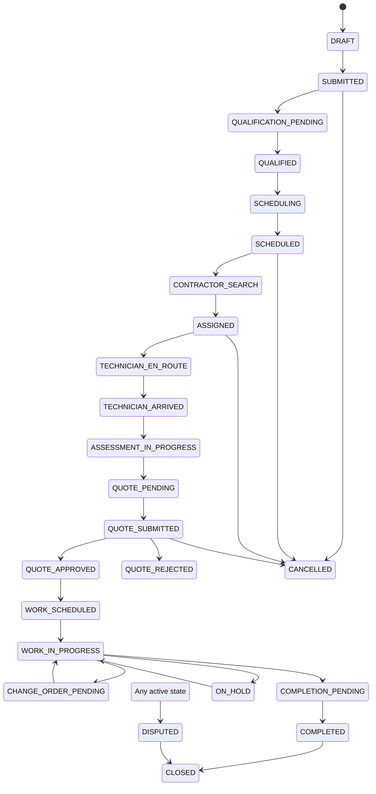

# Service Request State Machine

Transitions are centrally validated and append an `AuditEvent`. The API rejects arbitrary status writes. Quote approval freezes the accepted version; follow-up pricing must use a change order.
